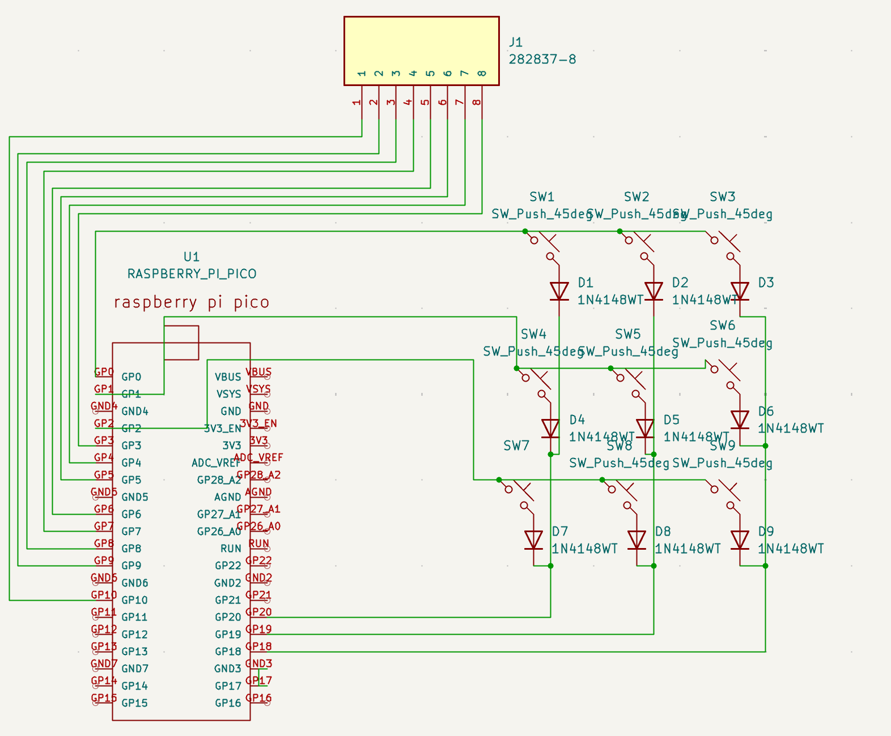
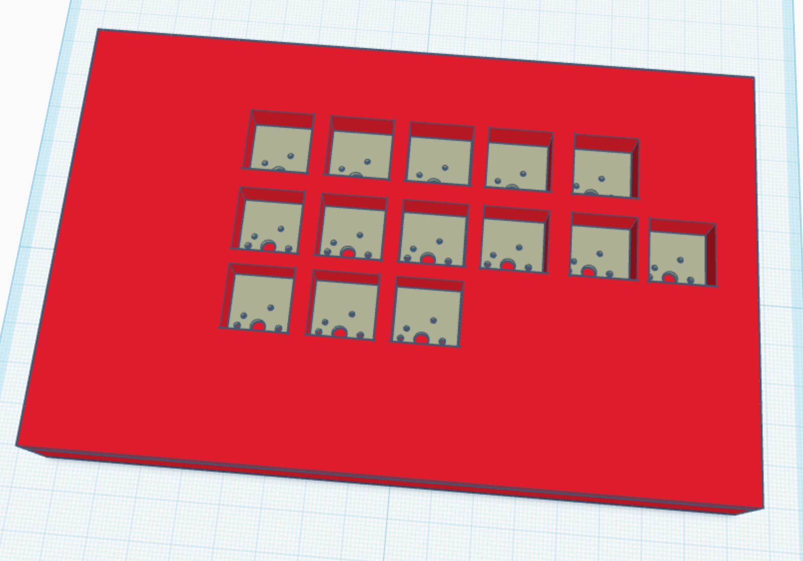
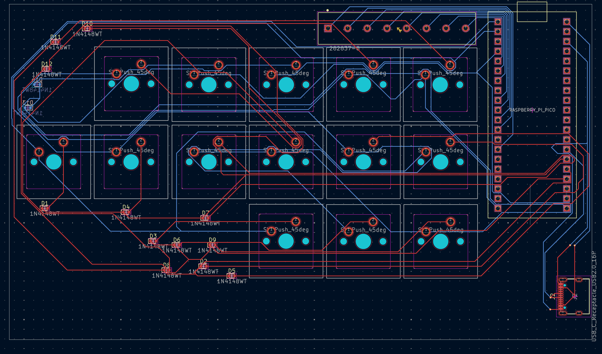
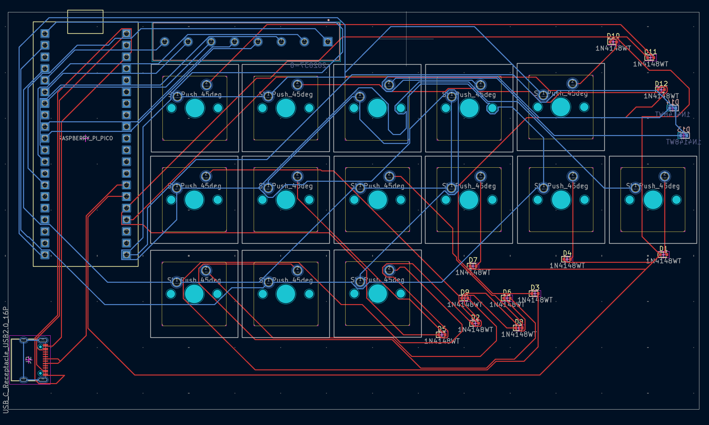
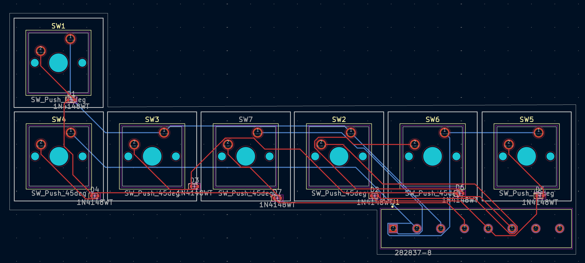
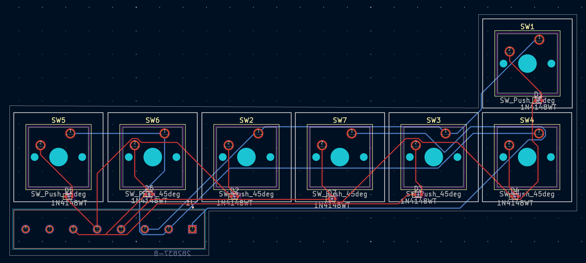

# Split-Steno-Qwerty-Keyboard

Modular and split keyboard designed to be affordable and easy to solder. 

Usage: create the 4 different pcbs and their respective cases solder all the components then flash the software (More detailes to be added later)
Taking inspiration from 2 keyboards a single keyboard used for stenography and another keyboard used for both stenography and qwerty typing i designed a keyboard with a layout of the 2 somewhat combined also split down the middle with a wire to connect them together. now the keyboard should be able to type in stenography for which it should have n-key rollover as well as all the keys to type regular qwerty style.   

The only requirements are a computer with the port to connect the keyboard and plover setup and configured on that same computer.

| Part    | Quantity | Price |
| ------- | -------- |-------|
| Type C recepticle 5 pack  |  1 | $2.44|
| RaspBerry Pi Pico | 2     |$5.20|
| Pogo connector 5 pack    | 1    |$1.23|
|Diodes 100pc|1|$1.88|
|Mechanical switches 50pc|1|$9.55|
|Total keyboard|1|$20.30|
